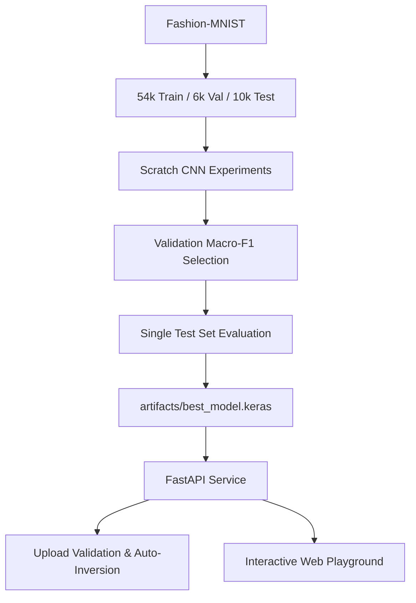

# VisionLab 2.0 — Scratch CNN + FastAPI

A reproducible deep-learning portfolio project that trains convolutional neural networks **from random initialization** on Fashion-MNIST and serves predictions through FastAPI with an interactive web playground.


---

## Benchmark Results (Measured & Reproducible)

Trained under fixed random seed (`seed=42`) with 54,000 training, 6,000 validation, and 10,000 test examples. Model selection was performed **strictly against Validation Macro-F1**; the test set was evaluated once only for the winning architecture.

### Variant Comparison

| Architecture | Parameters | Epochs | Training Time | Validation Loss | Validation Accuracy | Validation Macro-F1 | Result |
| :--- | :---: | :---: | :---: | :---: | :---: | :---: | :---: |
| **`baseline`** | 206,922 | 8 | 22.5s | 0.2221 | 91.72% | 0.9168 | Baseline |
| **`balanced`** | 421,642 | 8 | 45.7s | 0.2091 | 92.07% | 0.9199 | Runner-up |
| **`regularized`** | 422,026 | 8 | 63.7s | 0.2177 | **92.02%** | **0.9206** | 🏆 **Selected** |

### Final Test Set Evaluation (`regularized`)

- **Test Accuracy:** **91.52%**
- **Test Macro-F1:** **0.9154**
- **Test Weighted-F1:** **0.9154**
- **Test Loss:** 0.2323

### Evaluation Visualizations


---

## Features

- **Scratch CNNs**: 3 architectures trained from random weights (`baseline`, `balanced`, `regularized`) — no pretrained shortcuts.
- **Leak-Free ML Lifecycle**: Fixed split, early stopping, LR reduction, and validation-only selection.
- **Production Preprocessing Engine**:
  - **Alpha-channel safety**: Automatic compositing of transparent PNGs over a white canvas.
  - **Auto-inversion**: Dynamically detects light backgrounds and inverts them to match the Fashion-MNIST dark background distribution.
  - **Strict validation**: Rejects empty payloads, non-numeric arrays, NaNs, and files $> 5$ MB.
- **FastAPI Service**:
  - `POST /predict`: Top-3 classes, confidence, and full probability breakdown.
  - `GET /health` & `GET /ready`: Container liveness/readiness probes (returns HTTP 503 if model is missing).
  - `GET /model-info`: Live metadata and parameter counts.
  - `GET /demo`: Dark-mode interactive web dashboard with drawing canvas and live image inspector.
- **Test Suite**: 14 unit and contract tests via `pytest`.
- **Docker Support**: Containerized deployment with multi-stage Dockerfile and docker-compose.

---

## Architecture Flow



---

## Quickstart

### 1. Environment Setup

```powershell
# Using uv (fastest):
uv venv --python 3.11
uv pip install -r requirements.txt

# Or using standard python:
py -3.11 -m venv .venv
.\.venv\Scripts\Activate.ps1
pip install -r requirements.txt
```

### 2. Run Tests

```powershell
.\.venv\Scripts\pytest -v
```

All 14 tests covering preprocessing edge cases, output dimensions, probability distribution constraints, and API contracts will pass.

### 3. Run Experiments / Train

```powershell
.\.venv\Scripts\python -m scripts.train --epochs 8 --batch-size 128
```

Outputs generated:

- `artifacts/best_model.keras`
- `reports/confusion_matrix.png`
- `reports/classification_report.json`
- `reports/experiment_summary.json`
- `reports/<variant>/learning_curves.png`

---

## Run the API & Web Playground

Start the server:

```powershell
.\.venv\Scripts\uvicorn app.main:app --reload --port 8000
```

Open:

- **Interactive Playground**: `http://localhost:8000/demo` (or `http://localhost:8000/`)
- **Interactive Swagger Docs**: `http://localhost:8000/docs`
- **Health Check**: `http://localhost:8000/health`
- **Model Info**: `http://localhost:8000/model-info`

### Example CLI Prediction using Provided Samples

Test using the pre-extracted sample images in `samples/`:

```powershell
# Dark background sample:
curl.exe -X POST "http://localhost:8000/predict" -F "file=@samples/sneaker_dark_bg.png"

# Light background sample (auto-inversion verified):
curl.exe -X POST "http://localhost:8000/predict" -F "file=@samples/sneaker_light_bg.png"
```

Sample JSON response:

```json
{
  "predicted_class": "Sneaker",
  "confidence": 0.9841,
  "top_predictions": [
    {"class_name": "Sneaker", "probability": 0.9841},
    {"class_name": "Ankle boot", "probability": 0.0125},
    {"class_name": "Sandal", "probability": 0.0028}
  ],
  "probabilities": { ... },
  "inverted_background": true
}
```

---

## Docker Deployment

Build and run using Docker Compose:

```powershell
docker compose up --build
```

---

## Repository Structure

```text
├── app/
│   ├── main.py          # FastAPI application, middleware, endpoints
│   ├── model.py         # Model architecture & image preprocessing
│   ├── schemas.py       # Pydantic request/response schemas
│   └── templates/       # Interactive Web UI (index.html)
├── artifacts/
│   └── best_model.keras # Winning trained CNN model
├── reports/
│   ├── confusion_matrix.png
│   ├── classification_report.json
│   ├── experiment_summary.json
│   └── regularized/learning_curves.png
├── samples/             # Ready-to-test clothing sample images
├── scripts/
│   ├── train.py         # End-to-end benchmark & evaluation pipeline
│   └── extract_samples.py
├── tests/
│   ├── test_api.py      # FastAPI contract and validation tests
│   └── test_model.py    # CNN shape, probability, & preprocessing tests
├── Dockerfile
├── docker-compose.yml
└── requirements.txt
```

---

## License

This project is licensed under the MIT License - see the [LICENSE](LICENSE) file for details.
