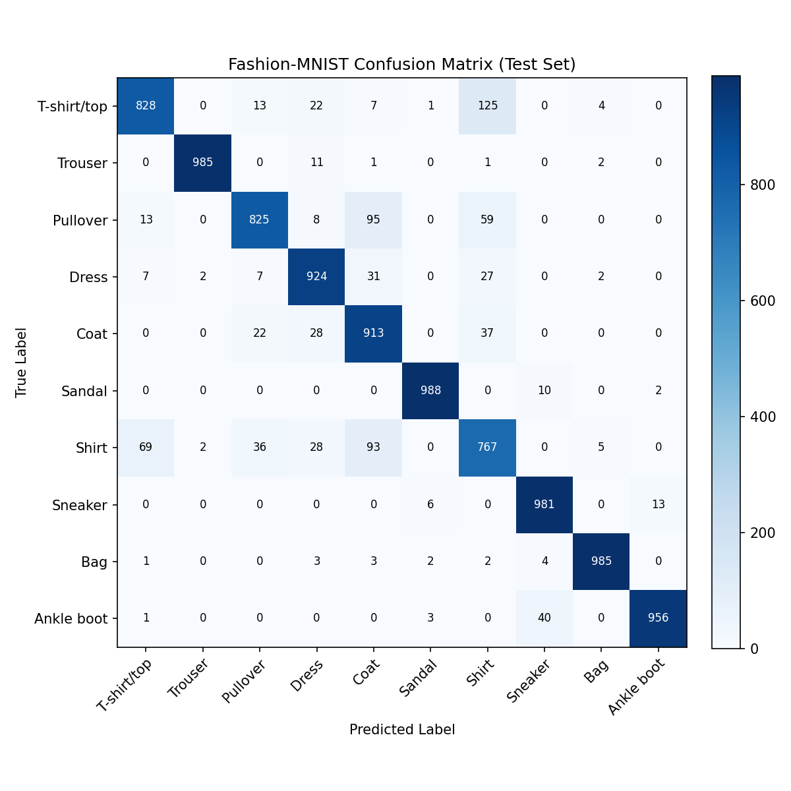
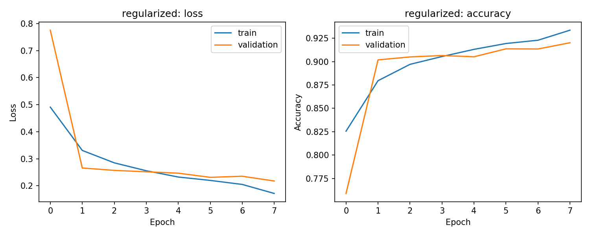

# VisionLab 2.0 — Scratch CNN + FastAPI

A reproducible deep-learning portfolio project that trains convolutional neural networks **from random initialization** on Fashion-MNIST and serves predictions through FastAPI with an interactive web playground.

[](https://github.com/mightyalok00/visionlab-cnn-fastapi/actions/workflows/ci.yml)


---

## Benchmark Results (Measured & Reproducible)

Trained under fixed random seed (`seed=42`) with 54,000 training, 6,000 validation, and 10,000 test examples. Model selection was performed **strictly against Validation Macro-F1**; the test set was evaluated once only for the winning architecture.

### Variant Comparison

| Architecture | Parameters | Epochs | Training Time | Validation Loss | Validation Accuracy | Validation Macro-F1 | Result |
| :--- | :---: | :---: | :---: | :---: | :---: | :---: | :---: |
| **`baseline`** | 206,922 | 8 | 22.5s | 0.2221 | 91.72% | 0.9168 | Baseline |
| **`balanced`** | 421,642 | 8 | 45.7s | 0.2091 | 92.07% | 0.9199 | Runner-up |
| **`regularized`** | 422,026 | 8 | 63.7s | 0.2177 | **92.02%** | **0.9206** | 🏆 **Selected** |

### Final Test Set Evaluation (`regularized`)

- **Test Accuracy:** **91.52%**
- **Test Macro-F1:** **0.9154**
- **Test Weighted-F1:** **0.9154**
- **Test Loss:** 0.2323

### Evaluation Visualizations




---

## Performance Benchmarks

Measured on CPU under documented conditions (`Python 3.11`, `TensorFlow 2.15.1`, `x86_64 CPU`, 20 warmup iterations). Results recorded in [`reports/benchmark_summary.json`](reports/benchmark_summary.json):

### Inference Latency & Scalability

| Workload | Batch Size | Median (p50) | 95th Percentile (p95) | Per-Image Latency | Throughput |
| :--- | :---: | :---: | :---: | :---: | :---: |
| **Single Image (Raw)** | 1 | 53.1 ms | 91.7 ms | 53.1 ms | 17.4 img/s |
| **API End-to-End** | 1 | 67.8 ms | 102.0 ms | 67.8 ms | 14.7 req/s |
| **Vectorized Batch** | 4 | 50.8 ms | 68.2 ms | 12.7 ms | 71.0 img/s |
| **Vectorized Batch** | 8 | 50.2 ms | 75.3 ms | 6.3 ms | 148.8 img/s |
| **Vectorized Batch** | 16 | 57.4 ms | 88.5 ms | **3.6 ms** | **275.8 img/s** |

*Note: Vectorized batch inference provides a **~15.8x throughput acceleration** over sequential single-image inference.*

---

## Model Reliability & Calibration

Detailed analysis provided in [`reports/model_reliability.md`](reports/model_reliability.md):

### Statistical Calibration (Test Set, N = 10,000)

| Metric | Score | Practical Significance |
| :--- | :---: | :--- |
| **Expected Calibration Error (ECE)** | **0.0196** | Gap between predicted confidence and true empirical accuracy is $< 2.0\%$. |
| **Maximum Calibration Error (MCE)** | **0.2615** | Peak calibration disparity occurring in low-sample intermediate bins. |
| **Brier Score** | **0.1199** | Mean squared probability error (0.0 represents perfect calibration). |
| **Mean Confidence** | **93.48%** | Average certainty over the test set (aligned with 91.52% empirical accuracy). |


### Auto-Inversion Risk Analysis

- **Detection Rate on White Backgrounds**: 99.98%
- **False Inversion Rate on Dark Backgrounds**: 0.02%
- **Edge-Case Warnings**:
  - Garments touching all 4 image borders may have their fabric confused for light background.
  - Mitigated via `auto_invert=false` parameter and UI toggle.

---

## Features

- **Scratch CNNs**: 3 architectures trained from random initialization (`baseline`, `balanced`, `regularized`) — no pretrained weights.
- **Grad-CAM Visual Saliency**: `/explain` generates activation heatmaps highlighting which garment regions drove the classification.
- **Hardened Vectorized Batch API**:
  - `POST /predict/batch`: Processes up to 16 images in a single vectorized pass.
  - **Payload limits**: Enforces 5 MB per file and 20 MB total batch payload (returns HTTP 413).
  - **Per-file diagnostics**: Reports individual file errors (corrupt, empty, unsupported MIME) rather than silently dropping uploads.
- **Production Preprocessing Engine**:
  - **Alpha-channel safety**: Automatic compositing of transparent PNGs over white.
  - **Auto-inversion**: Dynamically detects light backgrounds and inverts them to match Fashion-MNIST distribution.
- **FastAPI Service**:
  - `GET /health` & `GET /ready`: Container liveness/readiness probes (returns HTTP 503 if model is missing).
  - `GET /model-info`: Live metadata, parameters, and input contract.
  - `GET /demo`: Dark-mode interactive web dashboard with drawing canvas, Grad-CAM viewer, and probability distribution.
- **Test Suite**: 19 unit, contract, and integration tests via `pytest`.
- **Docker Verified**: Multi-stage Dockerfile with integrated `HEALTHCHECK` and automated CI startup validation.

---

## Quickstart

### 1. Environment Setup

```powershell
# Using uv (recommended, fastest):
uv venv --python 3.11
uv pip install -r requirements.txt

# Or using standard python:
py -3.11 -m venv .venv
.\.venv\Scripts\Activate.ps1
pip install -r requirements.txt
```

### 2. Run Tests

```powershell
.\run.ps1 test
# Or: .\.venv\Scripts\pytest -v
```

All 19 tests pass:

- Preprocessing constraints, invalid inputs (NaNs, shapes, bounds)
- Health and readiness states with/without model
- API contracts for `/predict`, `/explain`, and `/predict/batch`
- Hardened batch error reporting and limit enforcement
- Live artifact inference and Grad-CAM generation

### 3. Run Performance Benchmark

```powershell
.\.venv\Scripts\python -m scripts.benchmark
```

---

## Run the API & Web Playground

Start the server:

```powershell
.\run.ps1 serve
# Or: .\.venv\Scripts\uvicorn app.main:app --reload --port 8000
```

Open:

- **Interactive Playground**: `http://localhost:8000/demo` (or `http://localhost:8000/`)
- **Interactive Swagger Docs**: `http://localhost:8000/docs`
- **Health Check**: `http://localhost:8000/health`
- **Model Info**: `http://localhost:8000/model-info`

### Example CLI Requests

Test using sample images in `samples/`:

```powershell
# Single image prediction:
curl.exe -X POST "http://localhost:8000/predict" -F "file=@samples/sneaker_dark_bg.png"

# Grad-CAM Visual Explainability:
curl.exe -X POST "http://localhost:8000/explain" -F "file=@samples/sneaker_light_bg.png"

# Hardened Batch Prediction:
curl.exe -X POST "http://localhost:8000/predict/batch" \
  -F "files=@samples/sneaker_dark_bg.png" \
  -F "files=@samples/trouser_light_bg.png"
```

---

## Docker Deployment & Verification

Build and run using Docker:

```powershell
docker compose up --build
```

Verify container readiness:

```powershell
curl.exe http://localhost:8000/health
curl.exe http://localhost:8000/ready
```

Both endpoints return HTTP 200 with the model loaded and operational. The GitHub Actions CI pipeline also runs this verification on every push.

---

## Repository Structure

```text
├── .github/workflows/ci.yml     # Automated CI & Docker verification
├── app/
│   ├── main.py                  # FastAPI application, middleware, endpoints
│   ├── model.py                 # Architecture, preprocessing, Grad-CAM
│   ├── schemas.py               # Pydantic request/response schemas
│   └── templates/index.html     # Interactive Web UI with Grad-CAM viewer
├── artifacts/
│   └── best_model.keras         # Winning trained CNN model
├── reports/
│   ├── benchmark_summary.json   # Latency & throughput benchmarks
│   ├── classification_report.json # Per-class precision, recall, F1
│   ├── confusion_matrix.png     # Test set confusion matrix
│   ├── calibration_curve.png    # Reliability diagram & confidence histogram
│   ├── model_reliability.md     # ECE & background inversion analysis
│   └── regularized/             # Learning curves
├── samples/                     # 16 clean test images (dark & light bg)
├── scripts/
│   ├── benchmark.py             # Latency, throughput, and percentile benchmark
│   ├── extract_samples.py       # Sample extraction utility
│   ├── reliability_analysis.py  # ECE calibration & boundary evaluation
│   └── train.py                 # Multi-variant training & evaluation
├── tests/
│   ├── test_api.py              # API contract, batch, and explainability tests
│   └── test_model.py            # CNN shape, probability, & preprocessing tests
├── Dockerfile                   # Production container with HEALTHCHECK
├── docker-compose.yml
├── Makefile                     # Cross-platform task runner
├── pyproject.toml               # Project metadata & tool config
├── requirements.txt             # Pinned dependencies
└── run.ps1                      # Windows PowerShell task runner
```

---

## License

This project is licensed under the MIT License - see the [LICENSE](LICENSE) file for details.
