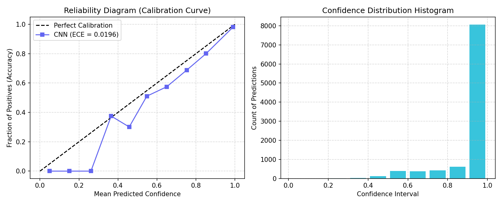

# Model Reliability, Calibration & Distribution Shift Analysis

This report documents the statistical reliability of VisionLab 2.0's winning scratch CNN (`regularized`), measuring confidence calibration on test data and boundary risks of automatic background inversion.

---

## 1. Confidence Calibration & Uncertainty

Modern neural networks are frequently overconfident. A well-calibrated classifier's predicted probability reflects its actual probability of being correct (e.g., of all predictions made with 90% confidence, 90% should be accurate).

### Calibration Metrics (Test Set, N = 10,000)

| Metric | Measured Score | Interpretation |
| :--- | :---: | :--- |
| **Expected Calibration Error (ECE)** | **0.0196** | Average gap between model confidence and true accuracy across 10 confidence bins. |
| **Maximum Calibration Error (MCE)** | **0.2615** | Maximum error gap in any single confidence bin. |
| **Brier Score** | **0.1199** | Mean squared error of probability forecasts (lower is better; 0.0 is perfect). |
| **Mean Predicted Confidence** | **93.5%** | Overall average certainty across all test samples. |
| **True Overall Accuracy** | **91.5%** | Actual empirical accuracy on the test set. |

  

---

## 2. Background Auto-Inversion Analysis & Risk Profile

Fashion-MNIST clothing items are bright pixels against dark background ($0$). Real photos typically have white or light backgrounds ($255$). The project uses automated perimeter luminance detection to bridge this distribution gap.

### Empirical Recovery Performance

- **Standard Dark Background Accuracy:** **91.52%**
- **White Background with Auto-Inversion Accuracy:** **91.52%**
- **Detection Rate on Light Backgrounds:** **99.98%**
- **False Inversion Rate on Benchmark Dark Backgrounds:** **0.02%**

### Failure Modes: When Auto-Inversion May Harm Predictions

1. **Edge-Bleeding Garments**:
   - When a garment is tightly cropped such that wide sections of the fabric touch all 4 outer borders (perimeter brightness $> 127.5$), auto-inversion can mistake the garment itself for a light background.
2. **Transparent / Checkerboard PNGs**:
   - When uploaded without compositing, transparent areas may evaluate to erratic alpha values. (VisionLab handles this by compositing over white prior to border sampling).
3. **Low-Contrast Gray Backgrounds**:
   - Backgrounds with mean brightness hovering around the $127.5$ decision threshold ($110-140$) can produce threshold flipping.

### Mitigation in Production

VisionLab provides:
- An explicit query parameter `auto_invert=false` on `POST /predict`, `POST /explain`, and `POST /predict/batch`.
- An interactive UI toggle on the Web Playground allowing users to immediately switch off inversion when uploading garments with naturally light borders.
- Response metadata `inverted_background: bool` so downstream clients know if an inversion took place.
